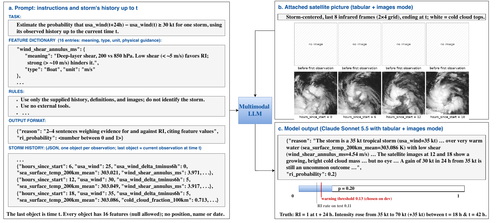

# Can Multimodal LLMs Predict Rapid Intensification? A Leakage-Controlled Zero-Shot Benchmark for Tropical Cyclones

This repository contains the official code for our **GeoCV Workshop @ WACV 2027** paper: **Can Multimodal LLMs Predict Rapid Intensification? A Leakage-Controlled Zero-Shot Benchmark for Tropical Cyclones**

## Overview

Rapid intensification (RI) is a rise of at least 30 kt in a tropical cyclone's maximum sustained wind within 24 hours. We test whether general-purpose multimodal LLMs can predict RI without task-specific training, and whether satellite images help.

We evaluate six commercial LLMs (GPT-5 mini, GPT-5.4 mini, GPT-5.6 Luna, GPT-6 Luna, Claude Haiku 5.5, and Claude Sonnet 5.5) on 2,485 six-hourly forecast cases from 140 storms (2016–2025). Each case gives the model the storm's history as 16 tabular features per observation, optionally with infrared images of the last eight observations. Storm names, dates, latitude, and longitude are removed so that models cannot recognise the storm and recall its outcome.

All six models reach PR-AUCs of 0.22–0.34, about two to three times the chance level of 0.11. Satellite images give no clear gain. An XGBoost model trained on 1980–2015 storms beats the best LLM (PR-AUC 0.439 against 0.344).



## Installation

```bash
python3 -m venv .venv
source .venv/bin/activate
pip install -r requirements.txt
```

## Data

| Set | Seasons | Storms | Cases (RI) | Use |
|---|---|---|---|---|
| Development | 2016 | 40 (20 with RI) | 720 (94) | choose each model's threshold |
| Test | 2017–2025 | 100 (50 with RI) | 1,765 (190) | final evaluation |

All inputs and model answers are included: storm data in `data/`, case files in `model_inputs/`, and raw answers in `results/`. Only the satellite images (about 900 MB) are not in git. `scripts/download_images.sh` rebuilds them.

## Building the benchmark

These steps rebuild the committed inputs. They are only needed to change the benchmark.

```bash
# Build the storm dataset from IBTrACS and ERA5 features
bash scripts/build_dataset.sh
# Sample dev/test storms and build all case files
bash scripts/build_prompts.sh
# Download and combine the GridSat-B1 satellite images
bash scripts/download_images.sh
```

To query the LLMs, open `notebooks/07a_run_claude.ipynb` (Anthropic) or `notebooks/07b_run_openai_gpt.ipynb` (OpenAI). Set the case file and model at the top, then run all cells. An API key is required.

## Evaluation

```bash
# Rebuild every table and figure from the saved answers (no API calls)
bash scripts/evaluate.sh
```

This scores the storm-identification probe, trains the XGBoost baseline, chooses each model's threshold on the development set, and scores the test set with storm-bootstrap confidence intervals. Tables go to `results/analysis/` and figures to `results/figures/`.

## Acknowledgements

- The ERA5 and satellite features, and the XGBoost setup, come from the [CCAI tropical cyclone RI tutorial](https://github.com/ccai-tropicalcycloneri-tutorial-2026/tropicalcycloneriprediction) (MIT License, Copyright (c) 2026 climatechange-ai-tutorials).
- Storm tracks are from [IBTrACS v04r01](https://www.ncei.noaa.gov/products/international-best-track-archive) and infrared images from [GridSat-B1](https://www.ncei.noaa.gov/products/gridded-geostationary-brightness-temperature), both by NOAA NCEI.
- Contains modified Copernicus Climate Change Service information (ERA5).

## License

This project is licensed under the **MIT License**. See the [LICENSE](LICENSE) file for details.
